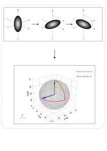

<h1 align="center">Particle OT dynamics</h1>

    <strong>Luis Ivan Cerezo Zepeda 1</strong>,
    <strong>Raúl Ignacio Hernández Aranda1</strong>  

    <small>
        1 School of Engineering and Sciences, Tecnológico de Monterrey, Mexico
    </small>

This repository contains numerical models developed to study the translational and orientational dynamics of elongated microalgae subjected to fluid flow and trapped with an Optical Tweezer. 

Depending the case, the model combines hydrodynamic rotation, active swimming, optical trapping and optical induced aligment to investigate the competition between fluid-particle and light-particle interactions. The diagram below represents how must be interpreted the simulations.

  

The microalgae is represented by its center of mass position

$$
\mathbf{R}(t)=(x,y,z)
$$
and its orientation vector 
$$\mathbf{p}=(p_x, p_y, p_z),\qquad ||\mathbf{p}|| = 1 $$

Its orientational dynamics are modeled from Jeffery's equation and progressively extended to include optical aligment torques, while its translational dynamics account for background flow, active swimming and optical trapping forces. 